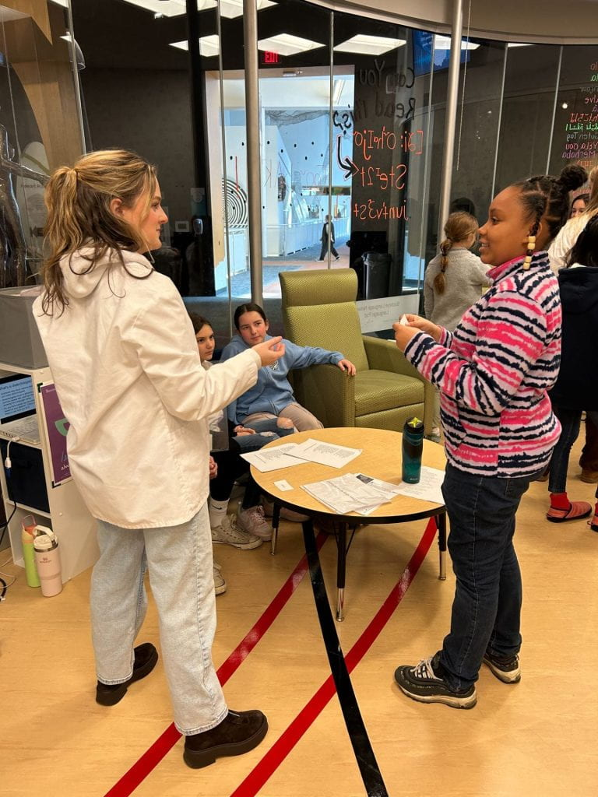

Post by Kyler Laycock, originally published on [Nikole Patson's site](https://u.osu.edu/patson.3/girl-scouts-at-the-language-pod/) in July 2025.

**Sparking early interest in language science with the Girl Scouts**

## Stuff we did

There are tons of channels for public engagement in Linguistics. We’ve
got no shortage of pop science articles, books, podcasts, and
(increasingly) YouTube and TikTok creators talking about language science outside an academic context. There are also a growing
number of programs for high schoolers that introduce them to linguistics
as a field. The audiences in these cases tend to self-select because
they already have an interest in (or at least some questions about)
linguistics.

When I teach or give demonstrations in these kinds of programs
(particularly at OSU’s [Summer Linguistic Institute for Youth
Scholars](https://linguistics.osu.edu/undergrad/sliys)), most of the
students participating already know that linguistics exists as a field,
and something about the ways linguists study human language. Which is
great (and evidence of all the hard work folks have been putting into
lingcomm generally!),  but doesn’t appear to be the norm for most high schoolers who aren’t choosing
to participate in these programs. As is the case with many linguists
including myself, it still seems like most undergraduate students
discover linguistics by chance after they’ve already started college.
Outreach toward younger kids exists, but ways to get people interested
and asking questions about language from an earlier age are a bit less
common than even programs targeted to high school students.

[Nikole Patson](https://u.osu.edu/patson.3/) and I developed a program
with the Girl Scouts to spark an interest in language science at an
earlier age. Nikole designed the activities around the requirements for
the cadet level (6-8th graders) public speaking badge. We had
around two dozen scouts come visit [the Buckeye Language Network
lab](https://u.osu.edu/thebln/language-pod/) for the event, and things
went so well that we’ve just scheduled it again for next year.

With the help of [Laura Wagner](https://u.osu.edu/wagner.602/) and her
students at the Language Pod, we led the girl scouts in activities that
fulfilled three requirements for the badge, but were designed to invite
them to think about language in ways that often aren’t highlighted to
kids around their age.

1.  **Performing emotional affect**: We prepared a few texts (most
    popularly a recipe from a box of Kraft Mac & Cheese) for the girls
    to read, and to repeat while performing different emotions (angry,
    sad, excited, etc). We talked about the different things we did with
    our voices, body language, and prosody that signal different
    emotions.
2.  **Poetry reading**: Scouts read
    [Jabberwocky](https://www.poetryfoundation.org/poems/42916/jabberwocky),
    [Mairzy Doats](https://en.wikipedia.org/wiki/Mairzy_Doats), and
    [Dandelions](https://www.poetryfoundation.org/poems/162078/dandelions-65ce681f387c5)
    (which we also watched performed in ASL). Along with each poem, we
    talked a bit about syntax/semantics, phonetics and phonology, and
    language modalities respectively.
3.  **Charades**: we came up with some easy to perform things
    (brushing teeth, swimming) and some hard to perform things
    (lemonade, oasis, shipwreck). Along the way, we talked about what made some of the concepts so hard, and why they were so much
    easier when we could use language.

We ended our time with a quick presentation and Q&A about the lab, the
people who work there, and careers in language science to really make it
clear that linguistics is a thing people do (and that we’re researching
language and asking some of the same questions the girl scouts had been
introduced to earlier that day)!

## How we made this happen (and how you can too):

Nikole initially reached out to the regional GS program manager and
strategic partnership coordinator. The two of them worked together to
see what badges might make sense for us to create a program for before
landing on public speaker. There are likely other options that might
work for different age groups depending on how you spin the program
([there are tons of badges, awards and Pins for Girl Scouts of different
age
groups]), (https://www.girlscouts.org/en/members/for-girl-scouts/badges-journeys-awards.html)
but the regional program manager also made a point to mention that the
programming doesn’t *have to* fill badge requirements—the Girl Scouts
have a long history of STEM programming and are always excited to add
more!

Once the general idea of the program was outlined and approved, the only
information they needed to add us to the [regional
calendar](https://www.gsoh.org/en/discover/activities/events.html) was:

-   Date/Time
-   Age Level
-   Price you will charge per girl (we were able to make this free
    thanks to the Language Pod at COSI)
-   Location
-   Three sentence description of the program

If you plan to reach out to a local coordinator, be aware a few details
might vary a bit depending on the regional branch of the Girl Scouts
you’re working with (including specific badge requirements).

## Looking ahead

We’re back on the Girl Scouts event calendar for this
year, and we’re excited to take what we learned from the first time and
continue improving the program! We’ve opted to stick with cadet level
scouts this time, but in the future would love to continue extending
outreach to other age groups.
