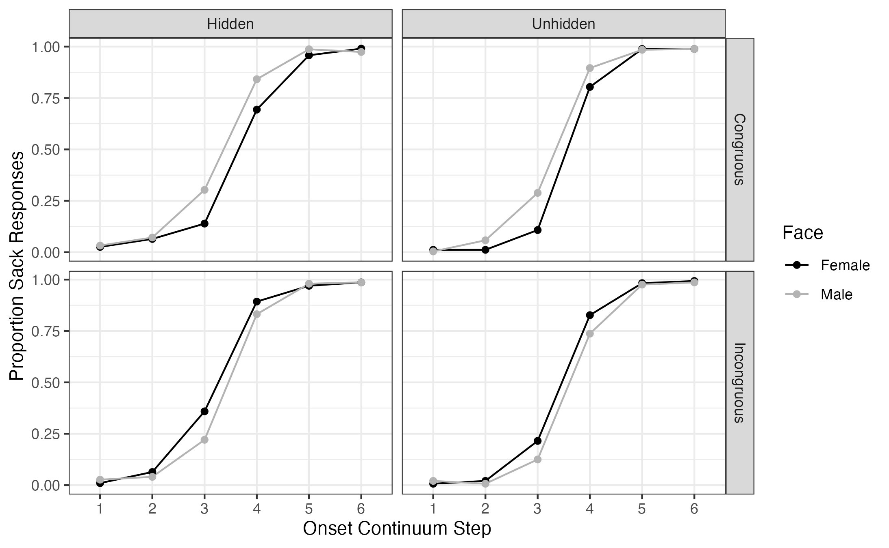
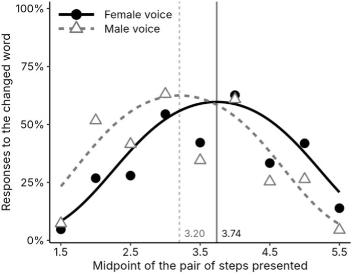

## Starting Points

A few things that are true of speech perception:

* Speech is social. When we speak, we convey a great deal of information about ourselves alongside linguistic messages
* When we hear speech, we interpret and construct social meanings from the variation in the signal
* And speech perception isn't just auditory! We're integrating visual information about talkers and their vocal tracts
* Perception isn't only signal-driven, even across modalities. Listeners use their beliefs,  expectations, and knowledge of the world to inform their perceptions and interpretations

So, in any instance of anyone hearing any word at all, there is a manifold of information to be processed.

 I'm interested in how all that information (visual, acoustic, social, linguistic, and so on) gets integrated in perception such that we can arrive at the meanings we make out of it, and do so with surprising consistency.

## Research Projects

### Matched guise and awareness

In sociophonetic experiments using Matched-Guise techniques, it's often assumed that participants must _believe_ that the stimuli are real (i.e., that there is a true link between a voice and social categories invoked alongside it), and that they must not be aware that anything in the task has been manipulated.These beliefs are also assumed to influence
perception below the level of introspective awareness.

[Kevin McGowan](https://vowel.space/) and I conducted a Matched-Guise task where we replicated the Strand Effect, the second experiment of Strand & Johnson (1996) where listeners perception of gender (cued by pictures of faces) shifted their perception of fricatives.

We revealed to participants that the faces and voices in the experiment weren't related or even the same person to see if belief in the stimuli mattered. It didn't! Fricative perception shifted the same ways whether we told listeners about the experiment in advance or not.

But when we paired faces and voices across gender categories, listeners only seemed to track the face, and to ignore the influence of the faces



### Geographic mobility and lexical processing


I've studied how listeners' experiences with dialect variation affects the dynamics of their lexical processing as part of an ongoing collaboration with [Cynthia Clopper](https://www.asc.ohio-state.edu/clopper.1/), [Marie Bissell](https://mariebissell.github.io/) , [Abby Walker](https://sites.google.com/vt.edu/abbyjwalker),[Larisa Bryan](https://cls.la.psu.edu/people/larisa-bryan/), Ohio State graduate student (Kevin Lilley), and undergraduate student (Declan Chandler-Holtz).

We've used a variety of methods and tasks to analyze how mono-dialectal and multi-dialectal listeners' exposure to specific dialect variants affects the time course of how they process speech in both familiar and unfamiliar varieties.


### Shadowing Voice quality

I investigated phonetic convergence to phonation type in a word shadowing task, and the extent to which listeners would converge toward variable voice qualities (breathy, creaky, falsetto) when repeating words after different talkers.

I also explored how explicit instructions to imitate the talker produced differed from implicit instructions to simply repeat.

Beyond the main finding (that listeners do converge to voice quality), it appears that explicit instructions to imitate result in increased awareness of phonetic detail that may lend itself to greater potential for inhibition of convergence in specific cases (e.g. decreased imitation of creaky voice in female talker female listener pairings), and to convergence to different acoustic parameters than seen in the implicit condition.



### Sociophonetic incongruity and cognitive control

I'm currently working on the effects of incongruity of social and phonetic cues on listeners' perceptions. At the moment, I'm following up on a curious result form the Matched Guise study I mentioned on this page.

When we paired faces and voices across gender categories, participants seemed like they ignored the face (or at least, we didn't find any effects of the face on perception at all).

I'm testing the ability of listeners to inhibit incongruent visual information in a series of experiments:

  - an oddball-style change detection/ discrimination task, to see if face can push the sibilant categories around like it does in identification tasks.

  

  - an extension of the matched guise identification task in Laycock and McGowan (2025) using video instead of static images, and concurrently stress testing the McGurk effect and Strand effect to see what kinds of incongruity each of them tolerate

  - a pupillometry study of the Strand effect with incongruent stimuli, to see if pupillary responses reveal anything about the integration (or lack thereof) of visual and auditory information, and what processing costs may be involved in both cases.

